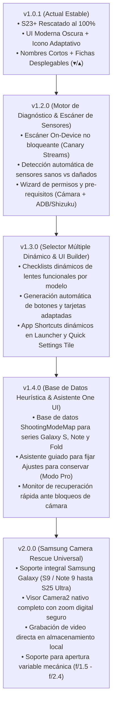
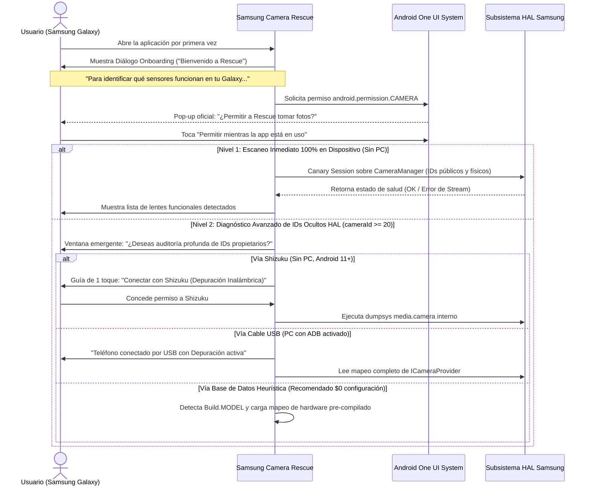

# Hoja de Ruta y Especificación Técnica — Samsung Camera Rescue

Este documento define la planificación técnica, límites de compatibilidad de hardware, requisitos de permisos y alcance funcional para las próximas versiones de **Samsung Camera Rescue** (actualmente implementada en su versión estable `v1.0.1` para el Samsung Galaxy S23+).

El proyecto se enfoca **exclusivamente en el ecosistema de dispositivos móviles Samsung Galaxy**, especializándose en superar las particularidades de su arquitectura de cámara propietaria (proveedor HAL `vendor.samsung.hardware.camera.provider`, servicio `cameraserver` con restricción de `cameraId >= 20`, tabla interna `ShootingModeMap` y capa One UI).

---

## 🗺️ Mapa de Versiones y Hitos de Desarrollo

---

## 📱 Matriz de Compatibilidad de Hardware y Versiones de Android / One UI

El alcance del proyecto cubre desde los primeros dispositivos Samsung con arreglos de cámaras múltiples y aperturas mecánicas hasta los flagships más recientes:

| Generación Samsung | Modelos Representativos | Versión Android / One UI Soportada | Arquitectura de Cámara | Particularidades y Estrategia de Rescate |
| :--- | :--- | :--- | :--- | :--- |
| **Galaxy S9 / S9+ / Note 9** | `SM-G960`, `SM-G965`, `SM-N960` | Android 8.0 (Oreo) hasta **Android 10 (One UI 2.5)** | • S9: 1 trasera (Gran Angular 12 MP con apertura mecánica dual $f/1.5 \leftrightarrow f/2.4$). • S9+ / Note 9: 2 traseras (12 MP 1x + 12 MP 2x Tele). | **Restricción de SO:** Android 10 no cuenta con `AccessibilityService.takeScreenshot()` (introducido en Android 11). El rescate trasero en estos modelos opera mediante **Modo Pro nativo directo** o visor `Camera2` propio de la v2.0 con control del diafragma mecánico. |
| **Galaxy S10 / Note 10** | `SM-G970`, `SM-G973`, `SM-G975`, `SM-N970`, `SM-N975` | Android 9.0 (One UI 1.0) hasta **Android 12 (One UI 4.1)** | Arreglo triple: Ultra-Wide (16 MP) + Wide 1x (12 MP apertura dual) + Telefoto (12 MP 2x). | Introducción de triple lente. En Android 11 y 12 soporta el 100% de las funciones (HUD flotante, Pro directo y visor integrado). |
| **Galaxy S20 / S21 / S22 Series** | `SM-G98x`, `SM-G99x`, `SM-S90x` | Android 10 (One UI 2.0) hasta **Android 15 (One UI 7)** | Sensores de alta resolución (64 MP / 108 MP) + Ultra-Wide + Telefoto 3x / Periscopio 10x. | Introducción de `BACK_SEAMLESS_ZOOM` (`device 20`). Fallos comunes en Ultra-Wide o Periscopio tras caídas. Bypass probado mediante `ShootingMode 3` (Pro) y `40` (QR). |
| **Galaxy S23 / S24 / S25 Series** | `SM-S91x`, `SM-S92x`, `SM-S93x` | Android 13 (One UI 5.1) hasta **Android 16+ (One UI 8+)** | Sensores GN3 (50 MP) / HP2 (200 MP) + IMX564 (Ultra-Wide) + 3x / 5x Tele. | **Arquitectura de referencia del proyecto.** Solución completa verificada en hardware real (`SM-S916U1`). |
| **Galaxy Note 20 / Note 20 Ultra** | `SM-N980`, `SM-N985`, `SM-N986` | Android 10 hasta **Android 13 (One UI 5.0)** | 108 MP / 12 MP + Ultra-Wide + Periscopio 5x con enfoque láser. | Compatible con desacoplamiento de láser AF y rescate de sensores independientes. |
| **Galaxy Z Fold / Z Flip (1 al 6)** | `SM-F9xx`, `SM-F7xx` | Android 10 hasta **Android 16+** | Cámaras de pantalla externa, trasera triple y cámara bajo pantalla (UDC). | Aislamiento de fallos en cable flex de bisagra o sensores secundarios. |
| **Galaxy A Series (A51 a A55, A71 a A73)** | `SM-A5xx`, `SM-A7xx` | Android 10 hasta **Android 15+** | Arreglos cuádruples económicos (Wide + Ultra-Wide + Macro + Profundidad). | Fallas frecuentes de sensor Macro/Ultra-Wide que colapsan la app nativa; rescate directo del sensor principal. |

---

## 🔑 Pre-requisitos del Usuario y Flujo de Onboarding para el Escaneo

Para que la aplicación pueda realizar el diagnóstico y escaneo sin fricciones, se establecen dos niveles de permisos claramente explicados al usuario mediante un diálogo interactivo:

### Detalle de los Pre-requisitos:
1. **Permiso de Cámara Básico (`android.permission.CAMERA`):**
   - **Requisito obligatorio:** Solicitado mediante la ventana emergente nativa de Android al iniciar el escaneo.
   - **Propósito:** Permite abrir y probar directamente los sensores públicos y físicos (ej. cámaras frontales `ID 1`/`3`, sensores estándar).
2. **Permiso de Accesibilidad (`RearCaptureService`):**
   - **Requisito opcional guiado:** Se presenta una tarjeta explicativa con un botón que abre directamente `Ajustes -> Accesibilidad -> Aplicaciones instaladas -> S23+ Camera Rescue`.
   - **Propósito:** Habilita el HUD flotante minimalista para capturar fotografías limpias del visor trasero en modo Escáner QR sin requerir root.
3. **Depuración USB / Depuración Inalámbrica (Auditoría Profunda):**
   - **Para usuarios generales:** **NO será obligatorio conectar el celular a la PC**. La aplicación incluirá una **base de datos interna pre-compilada** que asocia automáticamente el modelo exacto del dispositivo (`Build.MODEL`, ej. `SM-S916U1`, `SM-S908B`, `SM-G973F`) con sus IDs HAL independientes (`ID 56`, `ID 52`, etc.).
   - **Para usuarios avanzados / desarrollo:** Si el usuario tiene la "Depuración por USB" activada (como en tu configuración actual) o cuenta con **Shizuku** (depuración inalámbrica en el propio dispositivo), la app podrá leer en vivo `dumpsys media.camera` para descubrir IDs no documentados de forma 100% autónoma.

---

## 📦 Detalle de Versiones Planificadas

### 🔹 Versión 1.2.0 — Motor de Diagnóstico & Escáner Automático de Sensores
* **Canary Testing No Bloqueante:** Abre secuencialmente cada cámara en un hilo de fondo (`HandlerThread`), intenta compilar un stream mínimo (`OutputConfiguration`), atrapa excepciones a nivel de driver HAL (`CamxResultEFailed`, `ENOSYS`, `-38`) y cierra la sesión deterministamente sin congelar la interfaz.
* **Clasificador de Salud Óptica:**
  - `🟢 OPERATIVO`: El sensor responde y produce cuadros.
  - `🔴 DAÑADO`: Error de bus I2C o EEPROM rota (como el sensor `ID 2`/`58` en tu S23+).
  - `🟡 BLOQUEADO_EN_CASCADE`: Sensor sano pero inutilizable dentro de la multi-cámara por culpa de un sensor vecino.
  - `🔒 PRIVADO_PLATAFORMA`: Sensor trasero accesible solo vía Modos Pro / QR (`cameraId >= 20`).
* **Ficha Técnica en Pantalla:** Modelo de sensor (ej. `S5KGN3`, `IMX564`, `S5K3K1`), resolución real en megapíxeles, focal equivalente en 35mm, ángulo de visión y apertura.

---

### 🔹 Versión 1.3.0 — Selector Múltiple Dinámico & UI Builder Personalizado
* **Selector con Casillas de Verificación (Multi-Select Checklist):** Tras el escaneo, la app presenta la lista de cámaras que sí funcionan. El usuario puede marcar/desmarcar con qué sensores desea armar su cámara personalizada.
* **Construcción Dinámica de Interfaz:** Si el usuario está en un **Galaxy S22 Ultra** donde solo funciona la ultra-wide trasera y una frontal, la app genera automáticamente los botones específicos para ese hardware, sin código rígido.
* **App Shortcuts en el Launcher de One UI:** Mediante `ShortcutManager`, la app crea accesos directos dinámicos en el icono del launcher (al mantener presionado el icono de la app) y permite anclarlos directamente a la pantalla de inicio (ej. "Lente 1x Rescatado", "Lente Telefoto 3x").
* **Mosaico en Ajustes Rápidos (Quick Settings Tile):** Botón en la cortina de notificaciones de Android para abrir el lente rescatado principal con un toque.

---

### 🔹 Versión 1.4.0 — Mapeador Heurístico Samsung & Asistente One UI
* **Base de Datos Heurística de `ShootingModeMap`:** Diccionario integrado de mapeos de Samsung Camera para series S, Note, Z Fold/Flip y A, identificando automáticamente qué comandos (`CommandId.SHOOTING_MODE_PRO`, `SHOOTING_MODE_PRO_VIDEO`, `QR_SCANNER_MODE`, etc.) desacoplan los sensores sanos del grupo multi-cámara `BACK_SEAMLESS_ZOOM`.
* **Asistente Interactivo One UI:** Guía paso a paso adaptada al modelo detectado para activar "Ajustes para conservar -> Modo de cámara" (*Settings to keep*) en la cámara nativa de Samsung.
* **Mapeo de la Tecla Lateral (Side Key Quick Launch):** Guía asistida para reasignar el doble toque al botón de encendido (`Ajustes -> Funciones avanzadas -> Botón lateral -> Abrir aplicación -> S23+ Camera Rescue`) para quienes prefieran reemplazar totalmente la cámara nativa que se cuelga.
* **Detector de Bloqueos y Limpieza Automática:** Servicio en segundo plano que detecta si la cámara de Samsung quedó en bucle de error y la destraba al instante con un Intent de limpieza (`FLAG_ACTIVITY_CLEAR_TASK`).

---

### 🔹 Versión 2.0.0 — Samsung Camera Rescue Universal
* **Soporte Integral Samsung Galaxy:** Cobertura formal desde Galaxy S9/Note 9 hasta Galaxy S25 Ultra y plegables.
* **Visor Nativo `Camera2` de Pantalla Completa:**
  - Visor fotográfico autónomo de alto rendimiento dentro de la propia app para cualquier sensor que responda a la API pública.
  - **Zoom digital suave por software:** Deslizador de zoom fluido restringido estrictamente al sensor sano activo (sin saltar a sensores rotos).
  - **Manejo de Diafragma Mecánico Variable ($f/1.5 \leftrightarrow f/2.4$):** Control electrónico del electroimán de apertura para modelos S9, S10 y Note 9/10.
  - **Controles de captura:** Compensación de exposición manual (EV), control directo de linterna/flash, temporizador (3s, 5s, 10s) y cuadrícula de encuadre.
* **Grabación de Video Local:** Pipeline de grabación de video MP4 directo con audio estéreo sincronizado, guardado transaccionalmente en `Movies/S23Camera`.
* **Exportación e Importación de Perfiles de Diagnóstico (.json):** Capacidad de compartir perfiles de rescate entre usuarios con el mismo modelo y tipo de falla física.

---

## 📋 Matriz de Resumen por Versión

| Versión | Alcance | Hito Principal | Dependencia de Depuración USB |
| :--- | :--- | :--- | :--- |
| **`v1.0.1`** | Samsung S23+ | **Estable actual**: Rescate IDs 56, 52, 1, 3, UI moderna oscura, icono adaptativo, tarjetas técnicas ▾/▴. | Ninguna para uso diario (solo se usó en el diagnóstico inicial). |
| **`v1.2.0`** | Familia Samsung Galaxy | **Motor de Diagnóstico**: Escaneo canary on-device de sensores, reporte de salud por lente. | Opcional (Modo básico 100% en celular; ADB/Shizuku solo para auditoría interna). |
| **`v1.3.0`** | Familia Samsung Galaxy | **Selector Múltiple & UI Dinámica**: Checkboxes de lentes, generación dinámica de botones y App Shortcuts. | Ninguna (100% en celular). |
| **`v1.4.0`** | Familia Samsung Galaxy | **Auto-Matcher One UI**: Diccionario heurístico de modos Pro/QR por modelo y asistente de tecla lateral. | Ninguna (Base de datos pre-compilada). |
| **`v2.0.0`** | Ecosistema Samsung (S9 a S25+) | **Universal Samsung Rescue**: Visor completo nativo, diafragma mecánico variable, zoom digital por software y video MP4. | Ninguna (Completamente autónomo). |
