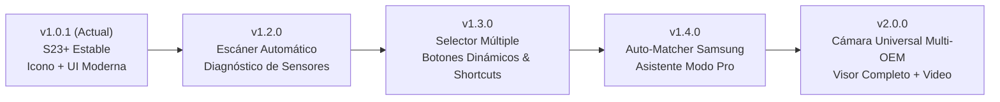

# Hoja de Ruta y Futuras Versiones — S23+ Camera Rescue

Este documento define la planificación técnica, arquitectura y alcance funcional para las próximas versiones de **S23+ Camera Rescue**. 

La versión actual (**`v1.0.1`**) cumplió el objetivo fundacional: rescatar el uso del **sensor trasero principal 1x (50 MP / 12 MP, `ID 56`)**, el **sensor telefoto 3x (10 MP, `ID 52`)** y las **dos cámaras frontales (`ID 1` e `ID 3`)** en el Samsung Galaxy S23+ sin necesidad de root, proporcionando interfaz moderna oscura, icono adaptativo, nombres cortos y acordeones técnicos desplegables (`▾` / `▴`).

El objetivo a largo plazo es transformar esta solución en un **Marco Dinámico y Universal de Rescate de Cámaras Físicas (Universal Hardware Camera Rescue)** capaz de diagnosticar automáticamente cualquier dispositivo Android con fallas de hardware en sensores individuales, aislar los componentes sanos y generar interfaces personalizadas.

---

## 🗺️ Mapa de Versiones y Entregables

---

## 📦 Detalle de Versiones Planificadas

### 🔹 Versión 1.2.0 — Motor de Diagnóstico & Escáner Dinámico de Sensores
**Objetivo:** Permitir que la aplicación examine de forma autónoma el subsistema HAL de cámaras del dispositivo conectado y distinga con certeza matemática qué sensores están operativos y cuáles tienen fallas de hardware o driver.

* **Escaneo Automático de Hardware (Hardware Sensor Prober Engine):**
  - Iteración sobre todos los Camera IDs públicos y lógicos expuestos por `CameraManager.getCameraIdList()`.
  - Detección de sub-cámaras físicas mediante `CameraCharacteristics.getPhysicalCameraIds()` (Android 9+ / API 28+).
  - Intento no bloqueante de inicialización (Canary Session): apertura breve y configuración de streams de prueba (`createCaptureSession`) con captura de excepciones aislada por sensor.
  - Clasificación de estado de cada sensor:
    - `🟢 FUNCIONAL`: Abre y entrega streams de vista previa sin errores.
    - `🔴 AVERÍA_FÍSICA`: Fallo en driver, bus I2C o EEPROM (`CamxResultEFailed`, `ENOSYS`, `Unavailable camera module`).
    - `🟡 BLOQUEADO_POR_GRUPO`: Sensor sano agrupado en un Camera ID lógico multi-cámara bloqueado por la falla de otro sensor adyacente.
    - `🔒 RESTRINGIDO_SISTEMA`: IDs reservados de plataforma (`cameraId >= 20` en Samsung) que requieren llamadas especializadas.
* **Ficha Técnica Automatizada en Pantalla:**
  - Desglose por sensor: Identificador HAL, fabricante/modelo (`S5KGN3`, `IMX564`, etc.), resolución máxima activa (MP), distancia focal equivalente en 35mm, ángulo de visión (FOV), apertura focal ($f/N$) y orientación del sensor.
* **Exportación de Reporte de Diagnóstico:**
  - Opción de exportar un reporte técnico detallado en texto o JSON para soporte y comunidad.

---

### 🔹 Versión 1.3.0 — Selector Múltiple Dinámico & Generador Automático de Accesos Directos
**Objetivo:** Adaptar dinámicamente la interfaz gráfica al hardware funcional específico detectado, permitiendo que el usuario elija exactamente qué cámaras desea activar.

* **Pantalla de Configuración Inicial (Wizard de Sensores Funcionales):**
  - Lista de verificación con casillas de selección múltiple (**Multi-Select Checkboxes**) que muestra únicamente los sensores que pasaron el escaneo de salud de la v1.2.0.
  - Ejemplos prácticos de adaptación:
    - En un **Galaxy S22 Ultra** donde solo funciona el lente Ultra-Wide trasero y una de las frontales: el usuario marca ambas y la app oculta los sensores principales y telefotos que provocan cierres forzados.
    - En un **Galaxy S23+**: selección de 1x Principal (`ID 56`), 3x Telefoto (`ID 52`) y Frontales (`ID 1`/`3`).
* **Generación Dinámica de Botones en la Interfaz (Dynamic UI Builder):**
  - La pantalla principal construye la botonera dinámicamente según la selección del usuario, sin configuraciones rígidas (*hardcoded*) en el código fuente.
  - Botones con etiquetas autogeneradas basadas en el rol óptico real (ej. `Cámara Trasera 0.6x (Ultra-Wide)`, `Cámara Trasera 3x (Tele)`, `Frontal 12 MP`).
* **Accesos Directos de Android (App Shortcuts & Quick Settings):**
  - Generación de accesos directos dinámicos en el lanzador del sistema (`ShortcutManager`): pulsación prolongada sobre el icono de la app para abrir directamente el lente rescatado deseado.
  - Posibilidad de anclar iconos directos en la pantalla de inicio para cada cámara funcional.
  - Quick Settings Tile ("Mosaico de Ajustes Rápidos") configurable para abrir el lente rescatado principal con un solo toque desde la barra de estado.

---

### 🔹 Versión 1.4.0 — Mapeador Heurístico de Samsung & Asistente de Auto-Configuración Pro
**Objetivo:** Extender la estrategia de bypass probada en el S23+ a otros modelos de la familia Samsung Galaxy y guiar al usuario para blindar su aplicación nativa contra cierres forzados.

* **Base de Datos Heurística de Mapeo de Intents (Vendor Mode Matcher):**
  - Biblioteca de compatibilidad decompilada de `ShootingModeMap` y `ShootingModeProviderImpl` para diversas generaciones de Samsung:
    - Series **Galaxy S20 / S21 / S22 / S23 / S24** (Snapdragon y Exynos).
    - Familias **Galaxy Note** y plegables **Galaxy Z Fold / Z Flip**.
    - Modelos de la serie **Galaxy A** con cámaras múltiples.
  - Mapeo automático de qué modos de disparo nativos (`Pro` = `3`, `Pro video` = `36`, `SCAN_QR_CODE` = `40`, `Food` = `13`, `Night` = `30`, `Expert RAW`) desacoplan el grupo multi-cámara (`BACK_SEAMLESS_ZOOM`) en el dispositivo específico.
* **Asistente Guiado de Configuración Permanente de Cámara:**
  - Guía visual interactiva dentro de la aplicación para activar "Ajustes para conservar -> Modo de cámara" (*Settings to keep -> Camera mode*) en la app nativa de Samsung.
  - Detector de estado colgado: si la cámara nativa se traba al cambiar por error al sensor dañado, una notificación o widget de rescate la destraba en milisegundos inyectando un Intent de limpieza (`FLAG_ACTIVITY_CLEAR_TASK`).
* **Validador de Permisos y Políticas de Accesibilidad:**
  - Comprobador automatizado del estado de `RearCaptureService` con acceso directo a ajustes si el servicio fue desactivado por el sistema de ahorro de energía.

---

### 🔹 Versión 2.0.0 — Universal Camera Rescue (Soporte Multi-OEM y Visor Completo)
**Objetivo:** Transformar la herramienta en una solución universal independiente del fabricante, incorporando un visor fotográfico completo dentro de la propia app para cualquier sensor utilizable vía Camera2.

* **Compatibilidad Multi-Fabricante (Universal HAL Bypass):**
  - Soporte para dispositivos de otros fabricantes donde la falla de una sub-cámara bloquea la app principal: Google Pixel, Xiaomi / Redmi / POCO, OnePlus / OPPO, Motorola.
* **Visor Completo y Avanzado dentro de la App:**
  - Implementación de un visor `Camera2` / `CameraX` nativo a pantalla completa para cualquier lente físico que responda a la API pública.
  - **Zoom digital suave** por software aplicado exclusivamente sobre el sensor sano seleccionado (sin alternar a sensores inexistentes o averiados).
  - **Controles fotográficos directos:**
    - Compensación de exposición manual (EV +/-).
    - Control dedicado de flash / linterna de hardware.
    - Cuadrícula de composición (regla de los tercios, proporción áurea).
    - Temporizador de disparo (3s, 5s, 10s) con sonido de obturador configurable.
* **Grabación de Video Directa:**
  - Pipeline de grabación de video MP4 con codificación H.264/H.265 y AAC guardado transaccionalmente en `Movies/S23Camera`.

---

## 📋 Matriz de Resumen por Versión

| Versión | Hito Principal | Capacidades Clave | Complejidad |
| :--- | :--- | :--- | :--- |
| **`v1.0.1`** | **Versión Actual Estable** | Rescate S23+ (IDs 56, 52, 1, 3), Modo Pro ISP, Modo QR + HUD, UI moderna oscura, icono adaptativo. | ✅ Implementado |
| **`v1.2.0`** | **Motor de Diagnóstico** | Escaneo automático de sensores, prueba no bloqueante de streams, reporte de salud por lente. | Media |
| **`v1.3.0`** | **Selector Dinámico & UI Builder** | Casillas de selección múltiple, generación dinámica de botones, App Shortcuts en launcher. | Media-Alta |
| **`v1.4.0`** | **Auto-Matcher Samsung** | Compatibilidad heurística multi-dispositivo (S20-S24, Note, Fold), asistente de configuración Pro. | Media |
| **`v2.0.0`** | **Cámara Universal Multi-OEM** | Visor completo nativo, zoom digital por software, video MP4, soporte para otras marcas. | Alta |
