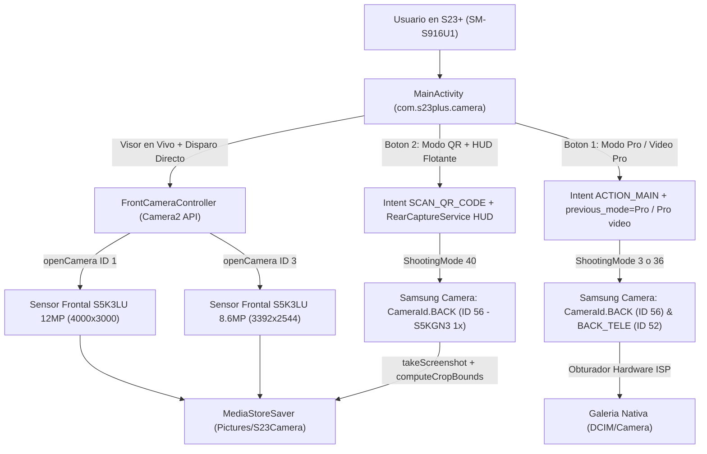

# Arquitectura de Software — S23+ Camera Rescue (`com.s23plus.camera`)

## 1. Diagrama de Flujo y Ruteo de Sensores

---

## 2. Responsabilidades por Módulo

| Archivo | Responsabilidad |
| :--- | :--- |
| [`CameraConfig.java`](../app/src/main/java/com/s23plus/camera/CameraConfig.java) | Constantes inmutables de hardware (`ID 1`, `ID 3`, `ID 56`, `ID 52`), acciones/extras de Intent verificados y cálculo geométrico puro (`computeCropBounds`) cubierto por pruebas unitarias. |
| [`FrontCameraController.java`](../app/src/main/java/com/s23plus/camera/FrontCameraController.java) | Gestión del ciclo de vida de `Camera2` (`CameraDevice`, `CameraCaptureSession`, `ImageReader`, `HandlerThread`) para las cámaras frontales `ID 1` y `ID 3`. |
| [`RearCaptureService.java`](../app/src/main/java/com/s23plus/camera/RearCaptureService.java) | HUD flotante (`TYPE_ACCESSIBILITY_OVERLAY`) y captura instantánea del visor trasero `ID 56` mediante `takeScreenshot(Display.DEFAULT_DISPLAY, ...)`. |
| [`MediaStoreSaver.java`](../app/src/main/java/com/s23plus/camera/MediaStoreSaver.java) | Persistencia transaccional de imágenes JPEG en `Pictures/S23Camera` utilizando `IS_PENDING`. |
| [`MainActivity.java`](../app/src/main/java/com/s23plus/camera/MainActivity.java) | Interfaz de usuario principal, coordinación de permisos y lanzamiento limpio de los modos traseros (`Pro`, `Pro video` y `SCAN_QR_CODE`). |
